# 🏏 Abhishek Jha
### Data Science Student | Developer in Progress

  
  

---

## 👋 About Me

Hey! I'm Abhishek, a Data Science student passionate about technology, cricket, and building useful projects.

- 🎓 Studying **B.Tech in Data Science**
- 💻 Learning **C++, Python, and Data Structures & Algorithms**
- 🤖 Exploring **Artificial Intelligence and Machine Learning**
- 🌐 Building websites and practical prototypes
- 🏏 Cricket lover who enjoys teamwork and continuous improvement

## 🚀 Featured Projects

| Project | Description |
|---|---|
| 🔥 **Ageni** | AI-based industrial fire detection, risk intelligence, and insurance-related insights. |
| 🆘 **Aid Link** | A concept for connecting people with volunteers and emergency assistance. |
| 🌐 **Cricket Portfolio** | My personal website showcasing my interests, learning journey, and projects. |

## 🛠️ Skills I'm Developing

  
  
  
  
  

## 📊 My GitHub Activity

  

  

---

### 🌅 Learn. Build. Improve. Repeat.

**Thanks for visiting my profile!**

[🏏 Visit My Interactive Portfolio](https://abhishek45jha-lab.github.io/)

