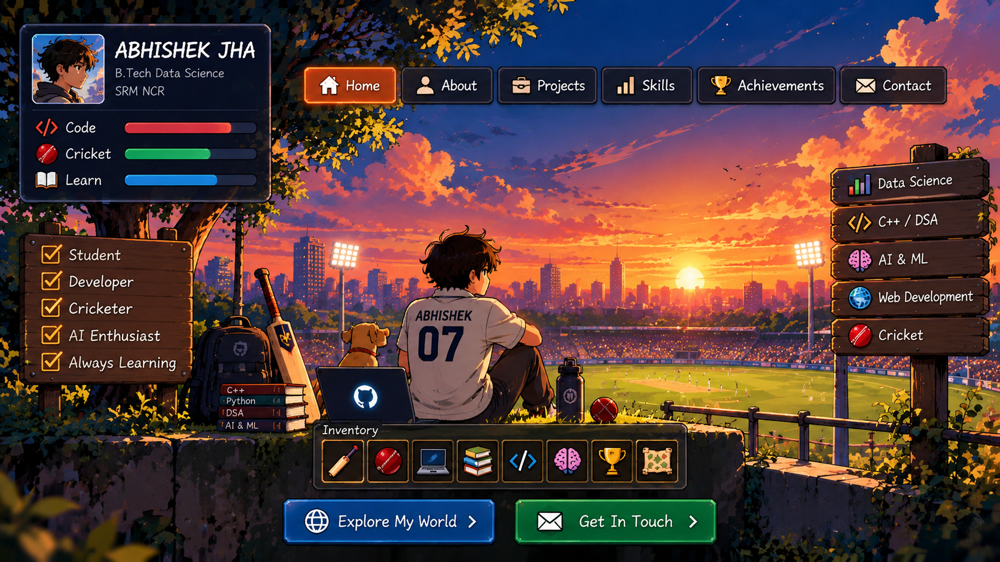

# 🏏 Abhishek Jha
### B.Tech Data Science · SRM NCR · Developer in Progress

[🌐 Open My Interactive Portfolio](https://abhishek45jha-lab.github.io/) · [💻 Explore My Repositories](https://github.com/abhishek45jha-lab?tab=repositories)

---

## 👋 About Me

I'm a Data Science student who enjoys cricket, coding, and building useful projects.

- 🎓 B.Tech in Data Science
- 💻 Learning C++, Python, and Data Structures & Algorithms
- 🤖 Exploring AI, Machine Learning, and web development
- 🏏 Cricket fan and lifelong learner

## 🚀 Featured Projects

| Project | Description |
|---|---|
| 🔥 **Ageni** | AI-based industrial fire detection and risk intelligence concept. |
| 🆘 **Aid Link** | A concept for connecting people with volunteers and emergency assistance. |
| 🌐 **Cricket Portfolio** | My personal website showcasing my interests, learning journey, and projects. |

## 🛠️ Skills I'm Developing

`C++` · `Python` · `Data Science` · `AI/ML` · `HTML` · `CSS` · `GitHub`

---

**Learn. Build. Improve. Repeat.**

[🏏 Visit My Interactive Portfolio](https://abhishek45jha-lab.github.io/)

